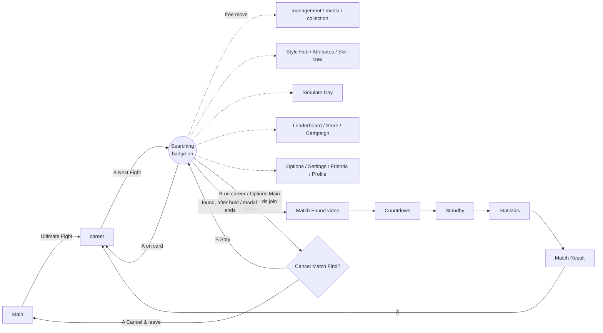

# Match Find in the background: plan (draft, not built)

## Today
- `mtx/js/components/mode-card.js` `startFind`: locks the screen (`is-find-lock`), disables other cards, replaces the hint bar with "Cancel match find".
- `mtx/js/app.js:290`: while `isFinding()`, every input is dropped except A / B, which cancel.
- Used in 2 places: career Next Fight (`screen-career.js:93`) and Main Quick Fight (`screen-main.js:84`).
- Found → `MTX_CLOBBY.startMatch` → Match Found video over the current screen → Countdown → Standby → Statistics → Match Result → `onExit` (career: `resolveFight`).

## New behaviour
1. Next Fight on career starts the search. Input is not locked. The player can open any screen inside Ultimate Fight and any overlay.
2. A small search badge (timer + mode, "Searching…") shows on every screen while searching. On career the Next Fight card keeps its find box.
3. Cancel: A on the Next Fight card again (or Y hint "Cancel find" on career only). B no longer cancels; B is normal back.
4. Leaving Ultimate Fight while searching → dialog "Cancel Match Find?" · A Cancel find and leave · B Stay (search continues).
5. Match found → close what is open on top, then play the Match Found video on the current screen, then the match. After Match Result → back to career.

## Ultimate Fight zone (search may continue)
career, management, media, collection, mastery (Style Hub), attributes, skilltree, rewards, quests, leaderboard, Simulate Day, Campaign (Event), store / pack via Upgrade, plus global overlays Options, Settings, Friends, Profile, History.
Leaving = the nav stack drops below `career` (B on career → Main), or Options › Main menu (log out), Options › Exit game, Friends › join a lobby / accept invite.

## Changes by file
| File | Change |
|---|---|
| `components/mode-card.js` | Split find state from the card: `find` keeps `mode, started, timer, onDone`; card box is only a view. New `mode: "bg"` option: no `is-find-lock`, no disabled cards, no hint swap. Add `getFind()`, `onChange` event for the badge. |
| new `components/find-badge.js` (+ css) | Global badge (top bar, beside wallet). Shows timer + mode. Hidden when not searching. Click / no input focus. |
| `app.js` | Line 290: lock only when the find is not `bg` (Main Quick Fight keeps the old lock). Wrap `show()` / `back()` / `showRoot()`: if searching and the target is outside the UF zone → open the leave dialog instead, go on only after A. |
| `app.js` (found) | `onDone` while busy: if a hold is active (Simulate Day, Tactical, Attributes), a dialog / modal is open, or a load screen plays → queue the found event until that ends (max ~3 s), then close Options / Settings / Friends / Campaign / dialog and play Match Found. |
| `screen-career.js` | `startNextFight` uses `bg`. A on the card while searching = cancel. `onExit`: `showRoot`-style return to career (stack Main › career) then `resolveFight`. |
| `screens/screen-options.js` (Main menu, Exit game) | Same leave dialog before logging out / exit. |
| Friends invite / join (`MTX_CLOBBY` open from Friends) | Same leave dialog. |
| `hint-bar` / `addLauncherHints` | No global swap anymore. Career gets `a:Cancel find` on the focused card while searching (via `data-focus-hints`). |
| `components/nav-graph.js` LINKS | career: "Next Fight → search runs in background"; add "#find-leave dialog"; Main/Options/Friends out: "leave dialog if searching". |
| css `is-find-lock` | Stays for Quick Fight only. |

## What this affects
| Area | Risk | Plan |
|---|---|---|
| Simulate Day (hold, Decline dialog) | Match found in the middle of a hold or card choice | Queue found until the hold ends / dialog closes. Simulated day is not undone. |
| Tactical / Attributes holds | Same | Queue until hold ends. |
| Tournament, Custom Lobby | Reached only from Main → leave dialog fires first, so never both at once. Friends invite into lobby → leave dialog. | OK |
| Character Select Back (Main → Char Select), Char Select → Login | Only from Main, after UF was left → search already cancelled. | No change. Leave dialog must not stack on these dialogs. |
| Settings | Overlay, allowed. Unsaved Settings + found: close Settings without saving (or queue until closed). | Decide: queue (recommended). |
| Campaign window / Store buy modal | Purchase modal open when found | Queue until modal closes. |
| Hint bar | Old global swap removed | Only career card hint. |
| Match Found / Loading / Match Result | Assume nothing else is open; `startMatch` uses `S.room` of Custom Lobby | Found must close overlays first; must not fire while Custom Lobby is open (it cannot be, by the zone rule). |
| Main Quick Fight | Outside UF | Keeps the lock (unchanged) unless you want it in the background too. |
| Nav stack | `onExit` returns to the screen that started it; now that may be any UF screen | Return to career always. |

## Flow

## Questions before building
1. Does Store (Upgrade) and Campaign count as inside Ultimate Fight? (Plan: yes when opened from career.)
2. Match found while a hold / modal is open: wait until it ends (plan) or interrupt at once?
3. Main Quick Fight: keep the lock, or move it to the background too?
